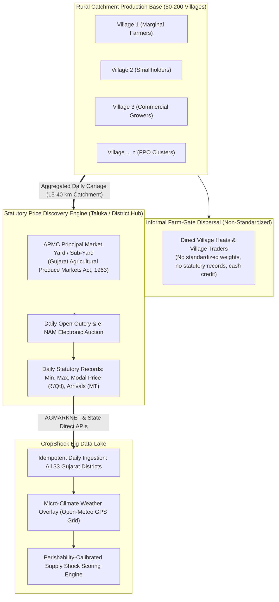
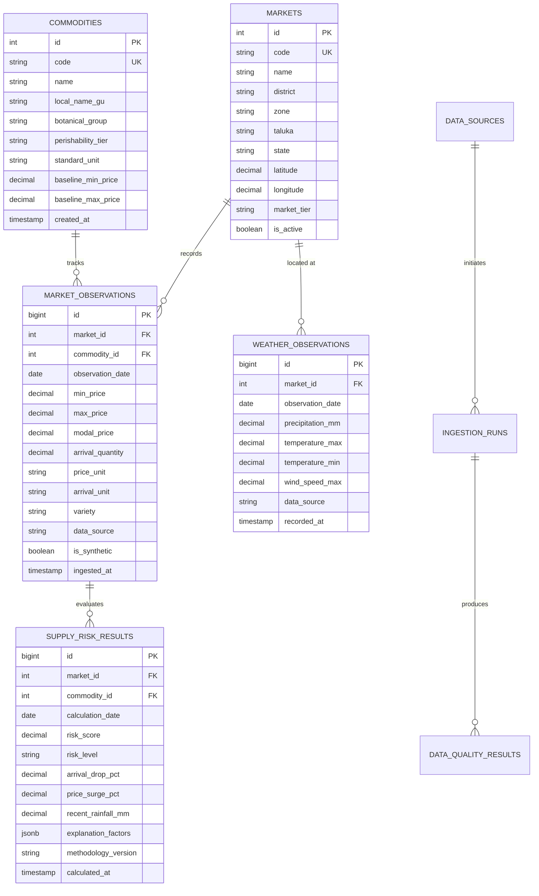

# CropShock: Agricultural Supply Chain & Market Intelligence Platform
## Phase 1: Requirement Analysis, System Architecture & Technical Specification (Exhaustive Gujarat Scope — All 33 Districts & All 35+ Vegetable Commodities)

**Author & Technical Architect:** Senior Data Engineer & Mentor  
**Target Audience:** Enterprise Data Engineers, AgTech Analytics Leads, Supply Chain Directors  
**Geographic Scope:** **All 33 Districts of Gujarat** (Taluka & District APMC Mandis across all 5 Agro-Climatic Zones)  
**Commodity Scope:** **Exhaustive Vegetable Master (35+ Commercial Vegetable Crops)**  
**Status:** Approved Architectural Specification  

---

## 1. Domain Architecture: Why Agricultural Data Aggregates at Taluka APMCs (Village vs Mandi Catchment Model)

A crucial technical distinction in AgTech Data Engineering is: **Why does public agricultural market intelligence operate at the APMC Mandi / Taluka level rather than the individual village level?**



### Key Architectural & Economic Realities:
1. **Statutory Price Discovery**: In India, individual villages do not possess statutory weighing scales, regulated auction pits, or daily market reporting authorities. Under the **Gujarat Agricultural Produce Markets Act (1963)**, regulated price discovery occurs at the **APMC Market Yards and Sub-Market Yards (ઉપ બજાર યાર્ડ)** located at Taluka and District headquarters.
2. **The 15–40 km Catchment Radius**: Each Taluka APMC yard serves as the natural economic funnel for **50 to 200+ surrounding rural villages**. When a supply disruption or weather event hits a village, its direct impact is reflected at the taluka APMC yard where the harvested produce is auctioned.
3. **Village-to-Mandi Lineage in CropShock**: CropShock models markets at the **APMC Mandi (Taluka / District)** node level, with market profiles maintaining metadata on their surrounding agricultural catchment districts, agro-climatic zones, and micro-climate coordinates.

---

## 2. All 33 Districts of Gujarat: Geographic Hierarchy & APMC Network

CropShock removes all geographic constraints, establishing full coverage across **all 33 administrative districts of Gujarat**, organized into 5 Agro-Climatic Zones:

```mermaid
graph TD
    GJ["State of Gujarat (33 Districts)"]
    
    GJ --> Z1["Saurashtra Zone (11 Districts)"]
    Z1 --> D_RKT["Rajkot (Gondal, Rajkot)"]
    Z1 --> D_BHV["Bhavnagar (Mahuva, Bhavnagar)"]
    Z1 --> D_JND["Junagadh & Gir Somnath (Junagadh, Kodinar)"]
    Z1 --> D_JMN["Jamnagar & Devbhumi Dwarka (Jamnagar, Khambhalia)"]
    Z1 --> D_AMR["Amreli (Amreli, Savarkundla)"]
    Z1 --> D_SND["Surendranagar (Surendranagar, Dhrangadhra)"]
    Z1 --> D_MRB["Morbi (Morbi, Wankaner)"]
    Z1 --> D_PBD["Porbandar (Porbandar)"]
    Z1 --> D_BOT["Botad (Botad, Gadhada)"]

    GJ --> Z2["Central Gujarat & Charotar (6 Districts)"]
    Z2 --> D_AMD["Ahmedabad (Jamalpur, Vasna, Naroda, Sanand)"]
    Z2 --> D_AND["Anand (Anand, Borsad, Khambhat)"]
    Z2 --> D_KHD["Kheda (Nadiad, Kapadvanj, Thasra)"]
    Z2 --> D_VAD["Vadodara (Sayajipura, Padra, Karjan)"]
    Z2 --> D_PNC["Panchmahal (Godhra, Halol)"]
    Z2 --> D_DHD["Dahod & Mahisagar (Dahod, Lunawada)"]

    GJ --> Z3["North Gujarat Zone (6 Districts)"]
    Z3 --> D_BK["Banaskantha (Deesa Potato Hub, Palanpur, Tharad)"]
    Z3 --> D_MSH["Mehsana (Mehsana, Unjha Spices Yard, Kadi)"]
    Z3 --> D_PTN["Patan (Patan, Sidhpur, Radhanpur)"]
    Z3 --> D_SK["Sabarkantha (Himatnagar, Idar, Talod)"]
    Z3 --> D_ARV["Aravalli (Modasa, Bayad)"]
    Z3 --> D_GND["Gandhinagar (Gandhinagar, Mansa, Kalol)"]

    GJ --> Z4["South Gujarat Zone (7 Districts)"]
    Z4 --> D_SRT["Surat (Surat APMC, Bardoli)"]
    Z4 --> D_NAV["Navsari (Navsari, Chikhli, Gandevi)"]
    Z4 --> D_VLS["Valsad (Valsad, Pardi, Dharampur)"]
    Z4 --> D_BHR["Bharuch & Narmada (Bharuch, Ankleshwar, Rajpipla)"]
    Z4 --> D_TAP["Tapi & Dang (Vyara, Songadh, Ahwa)"]

    GJ --> Z5["Kutch Zone (1 District)"]
    Z5 --> D_KCH["Kutch (Bhuj, Gandhidham, Anjar, Mandvi, Rapar)"]
```



---

## 3. Exhaustive Vegetable Commodity Taxonomy (35+ Crops)

The commodity catalog covers **all 35+ commercial vegetable varieties** cultivated, transported, and auctioned across Gujarat APMCs, categorized by botanical family, perishability tier, and shelf-life:

### 3.1. Solanaceous & Fruiting Vegetables
| Code | English Name | Gujarati Name (સ્થાનિક નામ) | Perishability Tier | Ambient Shelf-Life | Primary Weather Vulnerability |
| :--- | :--- | :--- | :--- | :--- | :--- |
| `TOM` | **Tomato** | Tameta (ટામેટાં) | Highly Perishable | 3 – 5 days | Unseasonal rain ('Mavthu'), extreme heat ($>40^\circ\text{C}$) |
| `BRN` | **Brinjal / Eggplant** | Ringan (રીંગણ) | Moderately Perishable | 4 – 6 days | Waterlogging, frost, shoot and fruit borer |
| `GCH` | **Green Chilli** | Lila Marcha (લીલાં મરચાં) | Moderately Perishable | 5 – 8 days | Heavy rainfall, damping off, heat shock |
| `CAP` | **Capsicum / Bell Pepper**| Simla Mirch (કેપ્સીકમ મરચાં) | Highly Perishable | 4 – 6 days | Heat-induced sunscald, fungal fruit rot |
| `SWC` | **Sweet Corn / Green Maize**| Makkai (લીલી મકાઈ) | Moderately Perishable | 4 – 7 days | Heat-induced kernel drying, moisture mold |

### 3.2. Cucurbits & Gourds (વેલાવાળા શાકભાજી)
| Code | English Name | Gujarati Name (સ્થાનિક નામ) | Perishability Tier | Ambient Shelf-Life | Primary Weather Vulnerability |
| :--- | :--- | :--- | :--- | :--- | :--- |
| `BGD` | **Bottle Gourd** | Dudhi (દૂધી) | Moderately Perishable | 6 – 10 days | Extreme heat, downy mildew after rain |
| `BTG` | **Bitter Gourd** | Karela (કારેલાં) | Moderately Perishable | 6 – 9 days | Continuous cloudiness, excessive moisture |
| `RGD` | **Ridge Gourd** | Turiya (તુરિયાં) | Highly Perishable | 3 – 5 days | Unseasonal rain (rapid surface rot), heat wilting |
| `SPG` | **Sponge Gourd** | Galka (ગલકાં) | Highly Perishable | 3 – 5 days | High humidity fruit rot, mechanical transit damage |
| `IVG` | **Ivy Gourd / Little Gourd**| Tindora / Giloda (ટીંડોરા / ગીલોડાં)| Moderately Perishable | 5 – 8 days | Fungal rot during transit waterlogging |
| `PTG` | **Pointed Gourd** | Parwal (પરવળ) | Moderately Perishable | 5 – 7 days | Flood submergence, root rot |
| `CUC` | **Cucumber** | Kakdi / Khira (કાકડી / ખીરા) | Highly Perishable | 3 – 6 days | Heat dehydration, powdery mildew |
| `PUM` | **Pumpkin** | Kolhu / Kaddu (કોળું) | Semi-Perishable (Storable) | 30 – 90 days | Moisture rot during storage/curing |
| `ASH` | **Ash Gourd / Winter Melon**| Petha / Safed Kolhu (પેઠા) | Semi-Perishable (Storable) | 45 – 90 days | Physical impact and peel lesion infection |

### 3.3. Legumes, Pods & Fresh Beans (શીંગો)
| Code | English Name | Gujarati Name (સ્થાનિક નામ) | Perishability Tier | Ambient Shelf-Life | Primary Weather Vulnerability |
| :--- | :--- | :--- | :--- | :--- | :--- |
| `OKR` | **Lady's Finger / Okra** | Bhindi (ભીંડા) | Highly Perishable | 3 – 5 days | Yellow vein mosaic, waterlogged roots, cold shock |
| `CLB` | **Cluster Beans** | Guar Phali (ગુવાર શીંગ) | Moderately Perishable | 4 – 7 days | Rain during harvesting, bacterial blight |
| `CWP` | **Cowpea / Long Beans** | Chawli / Chora (ચોળા શીંગ) | Highly Perishable | 3 – 5 days | High ambient heat wilting, pod blight |
| `FRB` | **French Beans** | Fansi (ફણસી) | Highly Perishable | 3 – 6 days | Temperature extremes, post-harvest snap loss |
| `GPE` | **Green Peas** | Vatana (લીલા વટાણા) | Highly Perishable | 4 – 6 days | Heat at pod development, moisture rot |
| `DRM` | **Drumstick / Moringa** | Saragvo (સરગવો) | Moderately Perishable | 6 – 10 days | Strong winds (pod breakage), transit snap |
| `PAP` | **Flat Beans / Hyacinth** | Papdi / Valore (પાપડી / વાલોર)| Moderately Perishable | 4 – 7 days | Aphid infestation, humid pod rot |

### 3.4. Leafy Greens & Fresh Herbs (ભાજી અને મસાલા)
| Code | English Name | Gujarati Name (સ્થાનિક નામ) | Perishability Tier | Ambient Shelf-Life | Primary Weather Vulnerability |
| :--- | :--- | :--- | :--- | :--- | :--- |
| `COR` | **Coriander** | Kothmir (કોથમીર) | Highly Perishable | 2 – 3 days | Heat wilting, slime rot from trapped rain moisture |
| `FEN` | **Fenugreek Leaves** | Methi (મેથીની ભાજી) | Highly Perishable | 2 – 3 days | High humidity leaf rot, rapid transit yellowing |
| `SPN` | **Spinach** | Palak (પાલક) | Highly Perishable | 2 – 3 days | Slime rot, leaf spot under heavy rain |
| `MNT` | **Mint** | Pudina (ફુદીનો) | Highly Perishable | 2 – 4 days | Dehydration in dry heat, mold under trapped moisture |
| `AMR` | **Amaranth Greens** | Tandoljo / Rajgira (તાંદળજો) | Highly Perishable | 2 – 3 days | Extremely delicate leaf structure, heat wilt |

### 3.5. Cole Crops (ક્રુસિફરસ શાકભાજી)
| Code | English Name | Gujarati Name (સ્થાનિક નામ) | Perishability Tier | Ambient Shelf-Life | Primary Weather Vulnerability |
| :--- | :--- | :--- | :--- | :--- | :--- |
| `CAB` | **Cabbage** | Kobi (કોબીજ) | Moderately Perishable | 7 – 14 days | Unseasonal rain head-splitting, internal black rot |
| `CAU` | **Cauliflower** | Fulaver (ફૂલાવર) | Highly Perishable | 4 – 7 days | Heat-induced curd yellowing/loosening, rain rot |
| `KNK` | **Knol Khol / Kohlrabi** | Ganth Kobi (ગાંઠ કોબી) | Moderately Perishable | 8 – 14 days | Woody fibrousness in dry heat |

### 3.6. Tubers, Bulbs & Root Vegetables (કંદમૂળ)
| Code | English Name | Gujarati Name (સ્થાનિક નામ) | Perishability Tier | Ambient Shelf-Life | Primary Weather Vulnerability |
| :--- | :--- | :--- | :--- | :--- | :--- |
| `POT` | **Potato** | Bataka (બટાકા) | Semi-Perishable (Storable) | 30 – 120 days | Winter frost blight (Deesa), storage heat rot |
| `ONI` | **Onion** | Dungri (ડુંગળી) | Semi-Perishable (Storable) | 20 – 90 days | Rain during lifting/curing (sprouting & neck rot) |
| `GAR` | **Garlic** | Lasan (લસણ) | Semi-Perishable (Storable) | 60 – 180 days | Moisture during sun-drying/curing (fungal rot) |
| `GNG` | **Ginger** | Aadu (આદું) | Semi-Perishable | 20 – 45 days | Rhizome rot caused by waterlogged clay soils |
| `CAR` | **Carrot** | Gajar (ગાજર) | Moderately Perishable | 7 – 12 days | Extreme heat core hardening, cavity spot |
| `RAD` | **Radish** | Mula (મૂળા) | Moderately Perishable | 5 – 8 days | Pithiness from water stress, leaf flea beetle |
| `BET` | **Beetroot** | Beet (બીટ) | Moderately Perishable | 10 – 18 days | High heat banding, post-harvest shrinkage |
| `SWP` | **Sweet Potato** | Shakarkand (શક્કરિયાં) | Semi-Perishable (Storable) | 20 – 45 days | Weevil attack, chilling injury below $10^\circ\text{C}$ |
| `YAM` | **Elephant Foot Yam** | Suran (સૂરણ) | Semi-Perishable (Storable) | 45 – 90 days | Bruising leading to bacterial soft rot |
| `COL` | **Colocasia / Taro Root**| Arbi / Patarveliya (અળવી ગંઠોડા)| Semi-Perishable (Storable) | 20 – 40 days | Storage moisture rots |

### 3.7. Acidic & Seasoning Fruits
| Code | English Name | Gujarati Name (સ્થાનિક નામ) | Perishability Tier | Ambient Shelf-Life | Primary Weather Vulnerability |
| :--- | :--- | :--- | :--- | :--- | :--- |
| `LEM` | **Lemon / Lime** | Limbu (લીંબુ) | Moderately Perishable | 10 – 20 days | Canker disease after rain, heat fruit drop |

---

## 4. End-to-End System Architecture

```mermaid
flowchart TD
    subgraph DataSources["External Data Ingestion Layer"]
        AGM["data.gov.in / Agmarknet API<br/>(Daily Mandi Arrivals & Prices for 33 Districts & 35+ Crops)"]
        MET["Open-Meteo Historical & Forecast Weather API<br/>(Hourly/Daily Weather for All District Coordinates)"]
        REF["Gujarat APMC Master Catalog<br/>(33 Districts, Catchment Metadata, GPS Grids)"]
    end

    subgraph Orchestration["Pipeline Orchestration (Apache Airflow)"]
        DAG1["Ingestion DAG: Bronze Landing & Checksum Validation"]
        DAG2["Transform DAG: PySpark Silver Cleaning & Partitioning"]
        DAG3["Quality DAG: Great Expectations / Schema Sanity Rules"]
        DAG4["Publish DAG: Gold Analytical Marts & Postgres Serving Sync"]
    end

    subgraph Medallion["Data Lake Storage (Medallion Architecture)"]
        subgraph Bronze["Bronze Layer (Raw Immutable Parquet/JSON)"]
            B1["Raw Daily Ingestion Batches (year=YYYY/month=MM/district=DISTRICT)<br/>Lineage: _ingested_at, _source_url, _batch_id, _raw_hash"]
        end
        subgraph Silver["Silver Layer (Cleaned, Standardized & Partitioned)"]
            S1["PySpark Deduplication on (market_id, commodity_id, observation_date)"]
            S2["Unit Standardization: ₹/Quintal & Metric Tonnes (MT)"]
            S3["Dynamic Commodity-Specific Sanity Bounds ($0 < P_{min} \le P_{modal} \le P_{max}$)"]
            S4["Data Quality Audit Telemetry & Null Metrics"]
        end
        subgraph Gold["Gold Layer (Analytical Marts & Feature Store)"]
            G1["gold_daily_market_aggregates (Statewide, Zonal, District & Mandi aggregates)"]
            G2["gold_commodity_baselines (7d, 14d, 30d Moving Averages & Volatility Bands)"]
            G3["gold_weather_impact_features (Precipitation, Heatwave, Cold Frost Shock)"]
            G4["gold_supply_risk_scores (Perishability-Calibrated Transparent Scoring)"]
            G5["gold_powerbi_star_schema (Dimensional Export CSV/Parquet)"]
        end
    end

    subgraph Serving["Serving Layer (Low-Latency Relational & API)"]
        PG[("PostgreSQL 16 Database<br/>Normalized 3NF Tables, Multi-Column B-Tree Indexes")]
        API["FastAPI High-Performance Backend (Python 3.12+)<br/>Async SQLAlchemy, Pydantic v2 Schemas, In-Memory Caching"]
    end

    subgraph Presentation["Presentation & Decision Intelligence"]
        UI["React 19 + TypeScript + Tailwind CSS Modern Dashboard<br/>8 Specialized Pages, District/Zone Filters, Crop Selector, Heatmaps"]
        PBI["Power BI Compatible Analytics Export<br/>Star-Schema (Dim_Market, Dim_Commodity, Dim_Date, Fact_Arrivals)"]
    end

    DataSources --> Orchestration
    Orchestration --> Bronze
    Bronze --> Silver
    Silver --> Gold
    Gold --> PG
    PG --> API
    API --> UI
    Gold -.-> PBI
```



---

## 5. Medallion Big Data Architecture & PySpark Transformations

With **33 districts** and **35+ vegetable commodities**, the daily transaction volume scales into hundreds of thousands of historical data points, making distributed computation with PySpark essential:

### 5.1. Bronze Layer (Raw & Immutable)
- **Partitioning Strategy:**  
  `data/lake/bronze/agmarknet/year=YYYY/month=MM/zone=ZONE/batch_{uuid}.parquet`
- Ingests raw JSON/CSV feeds verbatim with cryptographic SHA-256 integrity checksums.

### 5.2. Silver Layer (Cleaned & Standardized)
- **PySpark Transformation Rules:**
  1. **Deduplication:** Composite key drop duplicates on `(market_id, commodity_id, observation_date)`.
  2. **Standardization:**
     - Prices converted to `DECIMAL(10,2)` in **₹/Quintal**.
     - Arrivals standardized to **Metric Tonnes (MT)**.
  3. **Dynamic Commodity-Specific Sanity Bounds:**
     - Enforces $0 < \text{min\_price} \le \text{modal\_price} \le \text{max\_price}$.
     - Outlier filter uses commodity-specific thresholds (e.g. Potato modal price $\le ₹5,000/Qtl$; Garlic modal price $\le ₹25,000/Qtl$; Leafy greens $\le ₹8,000/Qtl$).
     - Anomalous rows are routed to `silver_quarantine` with descriptive failure flags.

### 5.3. Gold Layer (Curated Analytical Datamarts)
- **Datamarts Created:**
  1. `gold_daily_market_aggregates`: Mandi-level and state-level daily price spreads and total tonnage across all vegetable commodities.
  2. `gold_commodity_baselines`: 7-day, 14-day, and 30-day moving averages (`MA_7`, `MA_14`, `MA_30`) and standard deviations:
     ```python
     w7 = Window.partitionBy("market_id", "commodity_id") \
                .orderBy("observation_date") \
                .rowsBetween(-6, 0)
     df_gold = df_silver.withColumn("ma_7_modal_price", avg("modal_price").over(w7)) \
                        .withColumn("ma_7_arrival_qty", avg("arrival_quantity").over(w7)) \
                        .withColumn("std_7_modal_price", stddev("modal_price").over(w7))
     ```
  3. `gold_weather_impact_features`: Joins 3-day rainfall accumulation and temperature extremes with subsequent market arrival deviations.
  4. `gold_supply_risk_scores`: Multi-dimensional risk score and component explainability vectors.

---

## 6. Multi-Commodity Explainable Supply-Risk Methodology

Risk scoring is calibrated by **perishability tier** to account for biological differences between leafy greens, fruiting vegetables, and storable root crops:

### 6.1. Dimension Weights by Perishability Tier

| Perishability Tier | Commodities Included | Arrival Weight ($w_A$) | Price Weight ($w_P$) | Weather Weight ($w_W$) |
| :--- | :--- | :--- | :--- | :--- |
| **Highly Perishable** | Tomato, Coriander, Methi, Palak, Okra, Cauliflower, Peas, French Beans, Gourds | **0.50** (Immediate arrival drop) | **0.30** (Price elasticity) | **0.20** (Rain/Heat direct field loss) |
| **Moderately Perishable** | Brinjal, Cabbage, Chilli, Capsicum, Cucumber, Sweet Corn, Drumstick, Bitter Gourd | **0.45** | **0.35** | **0.20** |
| **Semi-Perishable (Storable)**| Potato, Onion, Garlic, Ginger, Yam/Suran, Sweet Potato, Pumpkin | **0.35** (Buffer stocks dampen drop) | **0.45** (Speculative price surges) | **0.20** (Storage/curing damage) |

### 6.2. Weather Disturbance Sub-Score ($S_W$) Calibration:
- **Rainfall Shock:**
  - 3-day cumulative precipitation $> 60\text{ mm}$ (Unseasonal 'Mavthu' or monsoon depression) $\implies S_W = 85$ for High/Moderate Perishables; $S_W = 75$ for Storable crops.
- **Heatwave Shock:**
  - $T_{\max} \ge 41^\circ\text{C}$ for 3 consecutive days $\implies S_W = 80$ for Tomatoes, Okra, Cauliflower, Leafy Greens; $S_W = 40$ for Potato/Garlic.
- **Cold Wave / Frost Shock (North Gujarat - Deesa/Banaskantha):**
  - $T_{\min} \le 5^\circ\text{C} \implies S_W = 75$ for Potato (frost blight risk).
- **Normal Weather:** $\implies S_W = 15$.

### 6.3. Composite Risk Tiers:
$$\text{SupplyRiskScore} = \left(w_A \times S_A\right) + \left(w_P \times S_P\right) + \left(w_W \times S_W\right)$$
- **LOW ($0 - 34$):** Stable arrivals, standard seasonal price fluctuations.
- **MODERATE ($35 - 69$):** Emerging arrival contraction or price inflation; recommends activating secondary APMCs.
- **HIGH ($70 - 100$):** Acute supply deficit; immediate procurement alert for FPOs, processors, and retail chains.
- **Guard:** If $< 3$ observations in past 7 days $\implies$ output `"INSUFFICIENT_DATA"` state to prevent phantom risks.

---

## 7. PostgreSQL Relational Serving Schema (3NF)



### Critical Performance Indexes:
```sql
-- Fast compound lookup for daily time-series analysis across all mandis & crops
CREATE UNIQUE INDEX idx_market_obs_lookup 
ON market_observations (market_id, commodity_id, observation_date);

-- Fast lookup for weather observation joins
CREATE UNIQUE INDEX idx_weather_lookup 
ON weather_observations (market_id, observation_date);

-- Fast filter for supply risk dashboards by date, commodity, and risk level
CREATE INDEX idx_supply_risk_filter 
ON supply_risk_results (calculation_date, commodity_id, risk_level);

-- Zonal and district filtering
CREATE INDEX idx_market_zone 
ON markets (zone, district, taluka);
```

---

## 8. Role-Oriented Frontend Experience (All 33 Districts & 35+ Vegetables)

1. **Executive Statewide Command Center**: State-level KPIs (Total daily tonnage across Gujarat, Average modal price index across all vegetables, Critical supply-risk alerts, Zone-wise breakdown).
2. **Main Gujarat Market Dashboard**: Interactive map of Gujarat with color-coded risk markers, dynamic commodity category filter (Leafy, Gourds, Tubers, Solanaceous, Legumes), and price volatility curves.
3. **Statewide Market Explorer**: Filterable directory of all APMC mandis; search by zone (Saurashtra, Central, North, South, Kutch) and district (all 33 districts), view daily arrival tonnage and price spread.
4. **Vegetable Intelligence Hub (Deep Dive per Commodity)**: Select any of the 35+ vegetables (e.g. Potato in Deesa, Onion in Mahuva, Tomato in Gondal, Palak in Ahmedabad) $\to$ view price bands, volume bars, moving averages, and weather overlay.
5. **Cross-Mandi Arbitrage Matrix**: Compare any 2 to 4 Gujarat mandis for any selected vegetable (e.g., Gondal vs Surat for Garlic; Deesa vs Ahmedabad for Potato; Mahuva vs Rajkot for Onion) with transportation net margin calculations.
6. **Procurement Cost Planner**: Allows food processors and aggregators to input required tonnage (e.g., 100 MT) and destination city $\to$ computes total landed cost across all active Gujarat mandis.
7. **Pipeline Observability & Data Quality**: Ingestion telemetry, record counts by zone, quarantine rejection rates, and live Open-Meteo API latency monitor.
8. **Power BI / Analytics Export Center**: Direct export of star-schema analytical tables (`Dim_Market`, `Dim_Commodity`, `Dim_Date`, `Fact_Arrivals`, `Fact_Supply_Risk`) for enterprise reporting.

---

## 9. Phased Execution Roadmap

- **Phase 1: Gujarat Statewide Architecture & Specification (All 33 Districts & 35+ Crops)** (**Approved**)
- **Phase 2: Statewide Data Sources & Resilient Ingestion Connectors** (Agmarknet, Open-Meteo live API, 33-district Gujarat master catalog, verified seed datasets with strict provenance)
- **Phase 3: Big Data Lake & PySpark Transformation Pipeline** (Bronze, Silver, Gold layers, multi-commodity deduplication, quarantine filtering, rolling baselines)
- **Phase 4: Apache Airflow DAG Orchestration** (Statewide scheduled daily pipelines, retry logic, task notifications, pipeline monitoring)
- **Phase 5: PostgreSQL Serving Layer & FastAPI Backend** (SQLAlchemy async models, Pydantic schemas, indexed queries, OpenAPI docs, unit & integration tests)
- **Phase 6: High-Performance React Frontend** (8 specialized pages, zone & commodity selectors, responsive Recharts, animated indicators, empty/loading/error states)
- **Phase 7: Explainable Business Analytics & Procurement Simulator** (Perishability-aware supply-risk engine, multi-mandi arbitrage calculator, Power BI export)
- **Phase 8: End-to-End Testing, Docker Containerization & Enterprise Documentation** (Full browser testing, comprehensive test suite, `system_architecture.md`, `README.md`)
